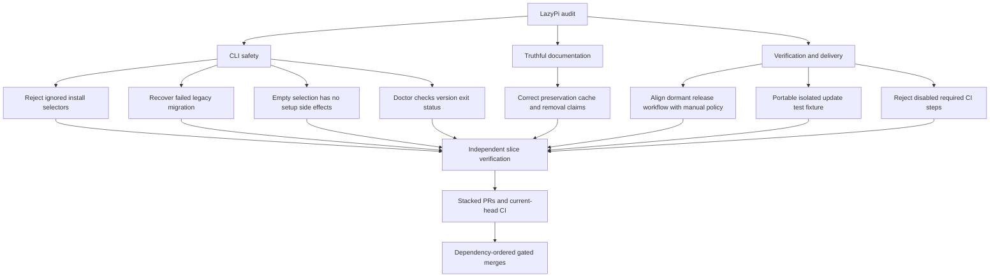

# LazyPi audit and verified stack
Objective: audit LazyPi, fix evidenced defects, and ship independently verified stacked PRs. Baseline: `156d66267a77ede9c95a4f5e45969315cff8085c`.
Branch: `audit/lazypi-safety-stack`. Delivery: auto-chain, stacked-to-master. Runner: `node --test`, `npm test`, `npm run spec:validate`.

## Specs

- S1. "review, audit the above, collect warnings issues, investigate". Target clarified verbatim as "LazyPi repository". Audit CLI behavior, current contracts and docs, tests, and delivery mechanics. Findings require source evidence and safe reproduction before code fixes. Distinguish warnings and unavailable proof.
- S2. "recursive plan into epics/issues graph". Maintain a finite dependency graph of evidenced issues with verification and PR boundaries. Stop decomposition at independently testable changes. GitHub Issues are disabled; keep the graph in this document without changing repository settings.
- S3. "build and update with verification skills/tools, build and verify". Add meaningful regression checks, required spec deltas, and proportional documentation. Preserve existing behavior outside accepted fixes. Run focused checks and required project gates. Use isolated temporary state for CLI probes. Migration clarification verbatim: "migrate, update or install updated alternatives" and "Yes, install the updated replacement first". Install the catalog replacement before removing legacy sources. Failed replacement installation must preserve legacy packages and their settings.
- S4. "with swarm, arena, interrogate". Use partitioned audit swarm, competing remediation plans with cross-judgment, and a diverse-model adversarial review of resulting patches. Record actual tool/model limitations rather than inventing evidence.
- S5. "new stacked prs, ship the stack then". Release-policy decision verbatim: "Remove the dormant publisher". Remove the dispatchable release publisher and stale documentation; do not publish npm packages. Deliver work-unit commits and stacked PRs, with independent per-PR verdicts and current-head required checks before dependency-ordered merges. User explicitly selected "Authorize GitHub delivery and gated merges" for `tommy-ca/LazyPi` using the existing gh session over HTTPS. No npm publication, deployment, force-push, or protection changes.

## Tasks

- T1 [S1,S2,S4] inline synthesis plus delegated read-only swarm/arena; complete; baseline gates and CLI/migration RED observed, Sol plan selected with cross-judge agreement.
- T2 [S3,S5] inline CLI safety fixes I1/I3/I4 with regression tests and spec delta; implementation checked, independent shipping verdict pending; RED observed, focused/full/spec GREEN; Risk item 3, shared argument handling and behavior contracts.
- T3 [S3,S5] inline install-first migration I2; pending implementation; Risk item 1, removal of an installed legacy source.
- T4 [S3,S5] inline documentation corrections I5; pending; passive structural verification.
- T5 [S3,S5] inline portable active-step verification I7/I8, then separate manual-release correction I6; pending; Risk item 5, CI and publishing mechanics.
- T6 [S3,S4,S5] delegated independent per-slice verification and interrogate, then parent GitHub delivery; pending; no merges before verdicts and gates.

## Log

### L1. Original request

"review, audit the above, collect warnings issues, investigate, recursive plan into epics/issues graph, build and update with verification skills/tools, build and verify, with swarm, arena, interrogate, new stacked prs, ship the stack then"

### L2. Scope and authority

- User selected "LazyPi repository" for the audit target.
- User selected "Authorize GitHub delivery and gated merges". Authorized destination is `tommy-ca/LazyPi`; use existing gh authentication over HTTPS, not ambient SSH.
- Preserve pre-existing untracked `openspec/changes/2026-09-02-skill-layer-governance/`. It is not part of this change.
- No `.atl/skill-registry.md` or Engram tool is available. Exact applicable skill paths are injected directly. Engram mirror is pending and unavailable, not synchronized.
- GitHub reports default branch `master`, viewer permission `ADMIN`, no open PRs in the bounded query, and Issues disabled. Do not enable Issues without explicit consent.

### L3. Baseline and audit evidence

- Parent observed `npm test` exit 0, 57 passed and 0 failed. Parent observed `npm run spec:validate` exit 0. Logs are `/tmp/lazypi-baseline.jJaVrz/test.log` and `/tmp/lazypi-baseline.jJaVrz/spec.log`.
- Audit swarm `01577033-3e09-4f45-ac14-f70631e0fb0c` partitioned CLI safety, contracts/docs, and verification/delivery. Reviewers were read-only and lacked execution tools. Their reproduction suggestions are not executed proof.
- Reports live under `/home/tommyk/.pi/agent/sessions/--home-tommyk-projects-lazypi--/subagent-artifacts/outputs/01577033-3e09-4f45-ac14-f70631e0fb0c/audit/` as `cli-safety.md`, `contracts-docs.md`, and `verification-delivery.md`.
- Parent spot-check of `cmdInstall` confirms Pi setup occurs before empty selection handling, and legacy removal occurs before replacement installation without recovery.

### L4. Initial epic and issue graph

Epic E0: verified LazyPi safety and truthful user guidance.

- I1 P1. `parseArgs` accepts installation selectors for other commands, whose handlers ignore them. Reproduce isolated `update --only fff` and `remove subagents --except subagents`; expected fix rejects before execution. Source `bin/lazypi.mjs:144-147,853,968-987`.
- I2 P1. Legacy removal succeeds before replacement install can fail. Existing spec requires removal first. Decide recovery policy after isolated reproduction; preserve pinned sources and object metadata. Source `bin/lazypi.mjs:424-433,710-726`.
- I3 P2. Empty unattended selection can still globally install Pi. Reproduce with isolated PATH and mocked npm. Source `bin/lazypi.mjs:624-640`.
- I4 P2. Doctor treats nonempty error output as a passing version check. Mock nonzero `--version` with stderr, preserve nonfatal warning semantics. Source `bin/lazypi.mjs:893-896`.
- I5 P2. Docs incorrectly promise configuration preservation, fresh runner downloads, no persistent artifacts, and describe removal selection backwards. Correct docs to match intentional model resets and backups. Source `docs/docs/index.html:17`, `docs/faq.html:66`, `docs/docs/installation.html:42`, `docs/docs/removing.html:12,29`.
- I6 P1 dormant. Dispatchable release workflow can publish without required gates, despite manual-only release policy. Inspect actual trigger and keep npm publishing outside this task. Source `.github/workflows/release-please.yml:41-47` and active release spec.
- I7 P1 portability. Update test uses Unix-only extensionless shell mock in the full Windows suite. Reuse existing platform-specific fixture pattern. Native Windows execution proof must come from CI. Source `test/update-selection.test.mjs:31-41`.
- I8 P2. CI contract tests accept commented or conditionally disabled commands. Prove with mutated fixtures and use the smallest check matching the workflow shape. Source `test/ci-workflows.test.mjs:17-28`, `test/catalog-contract.test.mjs:85-96`.

### L5. Throughput and boundaries

- Audit fan-out is read-only. Parent owns decisions, git, implementation, and integration. No parallel writer trigger is currently needed because CLI findings share one file and individual fixes are small.
- Estimated implementation is roughly 500-800 authored changed lines including regression checks and specs, subject to arena planning. These are forecasts, not measured diff counts. Slice by behavior, not file type. Proposed boundaries are CLI safety, migration recovery, truthful docs, and verification/delivery.
- Arena compares plans, not duplicate implementations. Laziness Protocol favors existing helpers and focused checks over a generic verification framework. Prove It Works requires real CLI probes, required gates, and independent shipping verdicts.
- Known open proof gaps are native Windows behavior, actual installed-Pi compatibility for `update --local`, and any live registry integration. No security-injection defect is asserted from source-only Windows argument tests.

### L6. Reproductions and migration decision

- Parent added public CLI regressions for I1/I3/I4 and observed all fail against unchanged implementation. I1 returned 0 and executed `pi update` instead of exit 2. I3 invoked mocked global npm setup and returned 127 instead of no-op success. I4 printed `✓ pi --version: Error: missing dependency` for a failed child.
- User correction verbatim on 2026-11-03: "migrate, update or install updated alternatives".
- User clarified verbatim on 2026-11-03: "Yes, install the updated replacement first". This authorizes changing removal-first ordering, not adding unrequested catalog alternatives. T3 and S3 updated accordingly.

### L7. Arena synthesis and release decision

- Original arena `b92e1c6f-a103-4dd5-b827-499137924e0b` produced Luna only. Configured Muse, Mimo, and DeepSeek models were absent from the active registry. No cross-provider diversity is claimed.
- Fallback arena `058036e8-6c39-42a4-9f2b-e2c8d57c356a` produced Sol and Terra candidates and an independent cross-judge. Parent read all full candidates. Choose Sol for explicit source pins, object metadata, local/global argv, and failure-path tests. Cross-judge agreed. Graft Terra's separate release-policy PR and Luna's fail-closed workflow checking. Reject old compensation advice, superseded by the user's migration decision.
- Planned stack is CLI safeguards, install-first migration, truthful docs, portable active-step CI checks, then manual-release policy. Each slice has its own tests/specs/docs where applicable and independent shipping verdict. No generic checker framework or new dependency.
- Real-Pi CI currently tests already-installed replacement convergence, not missing-replacement migration. Update that integration stage instead of claiming its existing coverage proves install-first migration.
- User decision verbatim on 2026-11-03: "Remove the dormant publisher". Delete the release-please workflow in its own slice, correct README, and guard the manual-only publishing policy. No npm publishing is authorized.
- Terra's FAQ link to disabled Issues is recorded as advisory I9. No substitute feedback destination is known. Do not invent one or enable Issues.
- Migration RED run observed failed assertions showing legacy removal before replacement installation in both scopes, with logs `/tmp/lazypi-baseline.jJaVrz/migration-red.log`. Existing convergence cases passed.

### L8. CLI safeguards checked

- Shared parser now rejects non-install selectors, empty unattended selection returns before Pi setup after settings validation, and doctor requires successful version execution before a pass.
- Focused CLI tests passed. Full `npm test` passed with 60 tests. `npm run spec:validate` passed. `git diff --check` passed. Full logs are `/tmp/lazypi-baseline.jJaVrz/cli-green.log`, `cli-suite.log`, and `cli-spec.log`.
- Baseline differential probe `/tmp/lazypi-baseline.jJaVrz/differential.mjs` observed identical stdout, stderr, and exit status for ordinary status, update, doctor, remove, selected install, and empty install with Pi present. Scratch baseline `/tmp/lazypi-cli-base.cFFtfw`; probe state `/tmp/lazypi-differential-6NSadp`.
- The next migration test file remains outside the worktree at `/tmp/lazypi-baseline.jJaVrz/migration-safety.test.mjs` until its own slice, so intentionally RED future work is not included in this commit.
- No formatter or generator is configured or needed. Deslop diff inspection found no new wrappers, dependencies, or explanatory comments. Independent shipping verdict remains pending.

